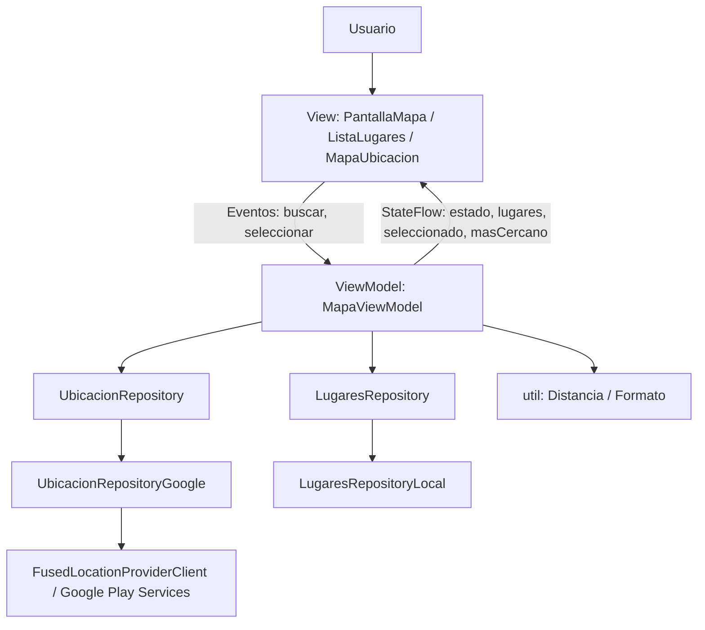

CampusGPS — Localización geográfica y lugares del campus
Laboratorio: GLAB-S13 · Desarrollo de Aplicaciones Móviles
Proyecto: CampusGPS
Estudiante: Sheila Aguirre Tejada
Paquete Android: com.aguirre.campusgps
Repositorio: Moviles_Android_Aguirre
Carpeta del proyecto: semana13/
Rama de la fase 1: main
1. Descripción
   CampusGPS es una aplicación Android desarrollada con Kotlin y Jetpack Compose que obtiene la ubicación del usuario, la representa en Google Maps y muestra cinco lugares ficticios del campus. Calcula la distancia entre la ubicación actual y cada lugar, ordena los resultados, permite seleccionar destinos y destaca el lugar más cercano.

La aplicación incorpora solicitud de permisos en tiempo de ejecución y manejo de errores para permisos denegados, ubicación desactivada o no disponible y ausencia de Google Play Services.
2. Objetivos
- Solicitar los permisos de ubicación precisa o aproximada cuando sean necesarios.
- Obtener las coordenadas actuales mediante FusedLocationProviderClient.
- Mostrar Google Maps con un marcador rojo de la ubicación del usuario.
- Representar cinco lugares del campus mediante marcadores azules.
- Calcular distancias en metros con Location.distanceBetween y mostrarlas en metros o kilómetros.
- Ordenar los lugares de menor a mayor distancia y mostrarlos en tarjetas.
- Permitir seleccionar un lugar y animar la cámara hacia él.
- Destacar el lugar más cercano con un marcador verde y un botón de navegación.
- Mostrar mensajes y acciones de recuperación ante errores de ubicación.
3. Tecnologías utilizadas
   Tecnología	Uso
   Kotlin	Lenguaje principal
   Jetpack Compose y Material 3	Interfaz declarativa
   Google Maps SDK / Maps Compose	Visualización del mapa y marcadores
   Google Play Services Location	Obtención de la ubicación
   FusedLocationProviderClient	Consulta de coordenadas
   Coroutines y StateFlow	Operaciones asíncronas y estado observable
   ViewModel	Lógica de presentación
   Repository	Abstracción de acceso a ubicación y lugares
   Git y GitHub	Control de versiones

Las versiones concretas de las dependencias se consultan en app/build.gradle.kts. Durante el desarrollo se ajustó Maps Compose para mantener compatibilidad con compileSdk = 35.

4. Estructura del proyecto
   semana13/
   ├── app/
   │   ├── build.gradle.kts
   │   └── src/main/
   │       ├── AndroidManifest.xml
   │       └── java/com/aguirre/campusgps/
   │           ├── MainActivity.kt
   │           ├── model/
   │           │   └── Modelos.kt
   │           ├── data/
   │           │   ├── UbicacionRepository.kt
   │           │   ├── UbicacionRepositoryGoogle.kt
   │           │   ├── LugaresRepository.kt
   │           │   └── LugaresRepositoryLocal.kt
   │           ├── util/
   │           │   ├── Distancia.kt
   │           │   └── Formato.kt
   │           ├── viewmodel/
   │           │   ├── MapaViewModel.kt
   │           │   └── CampusViewModelFactory.kt
   │           └── ui/
   │               ├── PantallaMapa.kt
   │               ├── MapaUbicacion.kt
   │               ├── ListaLugares.kt
   │               ├── MensajeError.kt
   │               └── theme/
   ├── local.properties           # Local, no se sube al repositorio
   └── README.md
5. Arquitectura MVVM + Repository

View: presenta el mapa, botones, tarjetas y errores; observa los StateFlow del ViewModel.
ViewModel: administra estados, solicita ubicación a las interfaces de repositorio, calcula distancias, ordena los lugares y registra la selección. No recibe Context.
Repository: encapsula la consulta de ubicación y proporciona los cinco lugares del campus.
Util: contiene funciones para calcular y formatear distancias.
6. Lugares ficticios del campus
   ID	Lugar	Categoría	Latitud	Longitud
   1	Biblioteca Central	Estudio	-12.0460	-77.0435
   2	Cafetería Campus	Comida	-12.0470	-77.0420
   3	Laboratorio de Cómputo	Estudio	-12.0455	-77.0415
   4	Auditorio Principal	Eventos	-12.0480	-77.0440
   5	Estacionamiento Norte	Servicios	-12.0440	-77.0430

Punto base de pruebas: latitud -12.0464, longitud -77.0428 (Lima). Las distancias mostradas dependen de la ubicación configurada en el emulador.
7. Funcionalidades implementadas
   7.1. Permisos de ubicación
   Al pulsar Obtener mi ubicación, la aplicación comprueba ACCESS_FINE_LOCATION y ACCESS_COARSE_LOCATION. Si no existe permiso, muestra la solicitud del sistema Android. Si se concede, inicia la búsqueda; si se deniega, informa del problema sin cerrar la aplicación.
   7.2. Mapa y marcadores
- Rojo: ubicación actual del usuario, con título Estás aquí.
- Azul: lugares del campus que no son el más cercano.
- Verde: lugar más cercano una vez calculadas las distancias.
- Cámara inicial en Lima con zoom 12.
- Animación hacia la ubicación actual con zoom 16.
- Animación hacia un lugar seleccionado con zoom 17.
  7.3. Distancias y lista
  Las distancias se calculan con Location.distanceBetween, se ordenan de menor a mayor y se muestran en una LazyColumn. Se expresan en metros enteros cuando son inferiores a 1000 m y en kilómetros con un decimal a partir de 1000 m. Al tocar una tarjeta, esta se resalta y el mapa se desplaza al destino.
  7.4. Lugar más cercano
  El ViewModel identifica el primer lugar de la lista ordenada que tiene una distancia calculada. El botón Ir al más cercano permanece deshabilitado hasta disponer de esa información. Al pulsarlo, selecciona el lugar y mueve la cámara.
  7.5. Manejo de errores
  Tipo de error	Mensaje	Acción
  SIN_PERMISO	No tienes permiso para acceder a la ubicación	Abrir ajustes de la aplicación
  GPS_APAGADO	Activa el GPS e intenta de nuevo	Reintentar
  SIN_PLAY_SERVICES	Este dispositivo no tiene Google Play Services	Sin botón
  OTRO	Mensaje descriptivo del problema	Sin cierre inesperado

8. Requisitos y ejecución
1. Abrir la carpeta semana13/ en Android Studio.
2. Utilizar un emulador Android con Google Play Services, preferentemente una imagen de sistema con Google Play.
3. Verificar que Maps SDK for Android esté habilitado en el proyecto de Google Cloud correspondiente.
4. Configurar la clave de Maps en el archivo local semana13/local.properties:
   MAPS_API_KEY=COLOCA_AQUI_TU_CLAVE_LOCAL
5. Verificar que local.properties esté excluido por .gitignore. Nunca publicar la clave real.
6. Sincronizar Gradle mediante Sync Project with Gradle Files.
7. Ejecutar Build → Make Project y abrir la aplicación en el emulador.
8. En el emulador, abrir Extended Controls → Location, establecer -12.0464, -77.0428 y seleccionar Set location.
9. Pulsar Obtener mi ubicación, conceder el permiso y comprobar el mapa, las distancias y la selección.
   Si la clave se expone accidentalmente en GitHub, revocarla o regenerarla en Google Cloud y revisar el historial del repositorio.

9. Evidencias: cinco capturas de pantalla
   Guardar las imágenes reales en la carpeta capturas/ junto a este README. Los siguientes nombres son sugeridos; deben coincidir con los archivos que se agreguen.
   Captura 1. Solicitud de permiso

Evidencia esperada: cuadro del sistema Android solicitando acceso a la ubicación.
Captura 2. Mapa y ubicación actual

Evidencia esperada: mapa, coordenadas y marcador rojo Estás aquí.
Captura 3. Marcadores del campus

Evidencia esperada: cinco lugares representados en el mapa, con el más cercano en verde cuando se haya calculado.
Captura 4. Lista ordenada por distancia

Evidencia esperada: tarjetas con nombre, categoría y distancia; una tarjeta seleccionada y el botón Ir al más cercano.
Captura 5. Manejo de errores

Evidencia esperada: permiso denegado con Abrir ajustes o ubicación desactivada con Reintentar.
10. Pruebas de aceptación
    Marcar cada prueba únicamente después de verificarla en el emulador.
- [ ] Al abrir la aplicación por primera vez y pulsar el botón, aparece la solicitud de permiso.
- [ ] Al aceptar el permiso, se ven latitud, longitud y el marcador Estás aquí.
- [ ] Al negar el permiso, aparece el error con Abrir ajustes y la aplicación no se cierra.
- [ ] En el punto base, aparecen los cinco marcadores de lugares cercanos.
- [ ] Al tocar un marcador, se muestran nombre y categoría.
- [ ] La lista está ordenada de menor a mayor distancia y usa m o km.
- [ ] Al tocar una tarjeta, se resalta y la cámara viaja al lugar.
- [ ] Ir al más cercano está deshabilitado antes de buscar y lleva al marcador verde después.
- [ ] Al cambiar la ubicación y buscar de nuevo, se actualizan distancias, orden y lugar verde.
- [ ] Con la ubicación desactivada, aparece el mensaje de GPS y Reintentar.
- [ ] Al rotar la pantalla, se conservan la ubicación y la lista.
- [ ] La clave real de Maps no está publicada y local.properties no se encuentra versionado.
11. Preguntas «Para pensar»
1. ¿Por qué FusedLocationProviderClient está dentro del Repository y no en el ViewModel?
   Porque el Repository es responsable de comunicarse con los servicios externos y obtener los datos de ubicación. El ViewModel solo utiliza la interfaz UbicacionRepository, por lo que no necesita conocer los detalles de Google Play Services ni trabajar directamente con Context. Esta separación facilita el mantenimiento, las pruebas y los cambios de implementación sin afectar la interfaz.
2. ¿Qué diferencia hay entre el permiso de ubicación y la clave de API de Maps? ¿Qué pasa si falta cada uno?
   El permiso de ubicación es una autorización que el usuario concede para que la aplicación acceda a su posición. La clave de API identifica y autoriza el proyecto que utiliza Google Maps. Si falta el permiso, la aplicación no debe acceder a la ubicación del usuario; si falta una clave válida, el mapa puede no cargarse correctamente aunque el permiso esté concedido.
3. ¿Por qué la clave va en local.properties y no en el código? ¿Qué harías si se subiera a GitHub por error?
   La clave se mantiene fuera del código fuente para evitar incluirla directamente en los archivos versionados. local.properties se excluye mediante .gitignore. Si la clave se publicara por error, la revocaría o regeneraría en Google Cloud, actualizaría la configuración local y revisaría el historial de Git para retirar la exposición. También mantendría las restricciones de aplicación y SHA-1. Esto reduce el riesgo de exposición, aunque una clave incluida en una aplicación distribuida no debe tratarse como un secreto absoluto.
4. ¿Dónde calculas la distancia y por qué no en el Composable?
   La distancia se calcula mediante la función distanciaMetros de util/Distancia.kt, llamada desde MapaViewModel al recibir la ubicación. No se calcula dentro del Composable porque la vista debe encargarse de representar el estado, no de realizar la lógica de negocio. Así se evita repetir cálculos innecesarios durante las recomposiciones y se respeta la arquitectura MVVM.
5. ¿Qué pasa con tu app si el usuario niega el permiso dos veces? ¿Cómo lo manejas?
   La aplicación permanece abierta y muestra un mensaje de permiso denegado. Se ofrece el botón Abrir ajustes, que lleva a la configuración de CampusGPS para que el usuario pueda conceder el permiso manualmente. No se debe intentar acceder a la ubicación sin autorización ni depender de que Android vuelva a mostrar el cuadro de permiso.
12. Historial de commits — Fase 1
    Commit	Descripción
    1	chore: importa proyecto base CampusGPS
    2	chore: configura permisos y clave de Maps con local.properties
    3	feat(ubicacion): pide permiso de ubicacion en tiempo de ejecucion
    4	feat(mapa): muestra mapa con marcador de la ubicacion actual
    5	feat(mapa): agrega marcadores de los lugares del campus
    6	feat(distancia): calcula y ordena lugares por distancia
    7	feat(ui): agrega lista de lugares y seleccion en el mapa
    8	feat(ui): resalta y navega al lugar mas cercano
    9	feat(errores): maneja permiso denegado, GPS apagado y sin Play Services
    10	docs: agrega README con estructura y capturas

Esta tabla documenta la secuencia planificada del laboratorio; verificar los commits realmente registrados con git log --oneline.

13. Conclusiones
1. Implementé una aplicación Android que obtiene y representa la ubicación del usuario en Google Maps.
2. Organicé el proyecto con MVVM y Repository para separar la interfaz de la obtención de datos.
3. Calculé y ordené las distancias a los lugares del campus para identificar el destino más cercano.
4. Incorporé una interfaz interactiva con marcadores, tarjetas y desplazamiento de cámara.
5. Gestioné errores de permisos, ubicación y servicios de Google para mejorar la experiencia de uso.